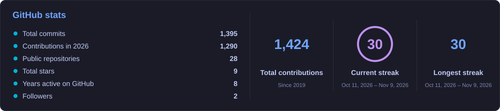
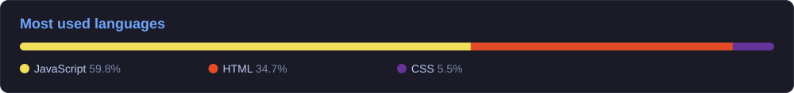

**Senior Software Engineer · 12+ years · Istanbul, Turkey · Open to remote roles**

## 👋 About me

I build backend systems that stay fast under load. Most of my career has been in **.NET Core / C#**, **microservices** and **SQL**, in fintech, energy, banking and SaaS products, from the first commit to production. I have also led a team, and I like improving the process around the code as much as the code itself.

Outside my day job I build **games** with Godot, Unity and web engines (PixiJS, Three.js), including custom shaders, Steamworks integration and Blender Python pipelines for assets. I work daily with **AI-assisted development** tools (Claude Code, Google Antigravity, Cursor) and **MCP** integrations.

## 🧰 Tech stack

> Most of my work lives in private repositories: client and employer projects under confidentiality agreements, and my own games and tools that are still unreleased. The stack above reflects what I use in them. The public projects below are small side projects; I'm happy to walk through code and architecture from my private work in an interview.

## 🎮 Side projects

| Project | Type | |
|---|---|---|
| [DX-Ball](https://github.com/ahmetbolukoglu/dxball-game) | browser game (JavaScript, Canvas) | |
| [Pomodoro Odak](https://github.com/ahmetbolukoglu/pomodoro-odak) | productivity | [▶ Play](https://ahmetbolukoglu.github.io/pomodoro-odak/) |
| [Kanban Pano](https://github.com/ahmetbolukoglu/kanban-pano) | productivity | [▶ Play](https://ahmetbolukoglu.github.io/kanban-pano/) |
| [Mini Blog](https://github.com/ahmetbolukoglu/mini-blog) | web app (drafts, publishing, tags) | |

## 📈 Stats

Cards are generated daily from live GitHub data by <a href=".github/workflows/profile-cards.yml">a GitHub Action</a> in this repository.
