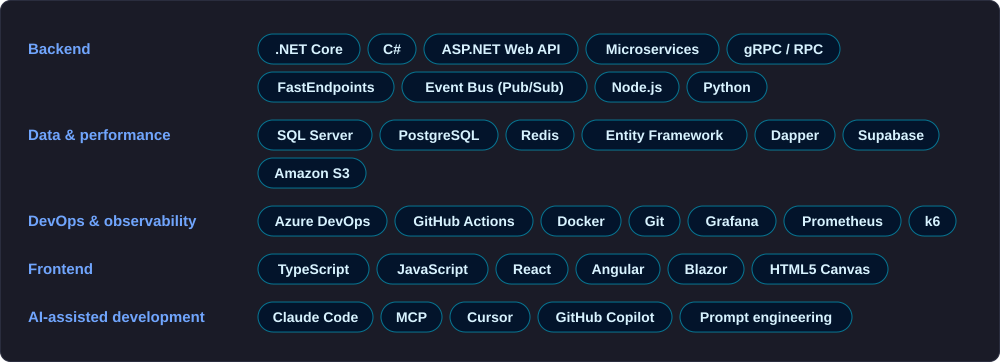
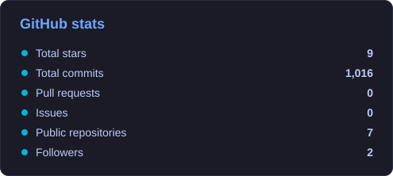
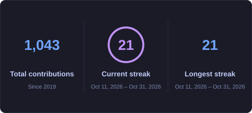

**Senior Software Engineer · 12+ years · Istanbul, Turkey · Open to remote roles**

## 👋 About me

I build backend systems that stay fast under load. Most of my career has been in **.NET Core / C#**, **microservices** and **SQL**, in fintech, energy, banking and SaaS products, from the first commit to production. I have also led a team, and I like improving the process around the code as much as the code itself.

These days I also work a lot with **AI-assisted development** (Claude Code, Cursor), **MCP** server/client integrations and small **JavaScript games**.

## 🛠️ What I have worked on

- **Real-time energy telemetry (EnerjiSA, solar power plant):** reporting on live production data collected from inverters and meters; fixed slow screens by adding Redis caching; monitoring and load testing with Grafana, Prometheus and k6.
- **Fintech microservices (Agrio Finans, QPay):** migrated services from gRPC to RPC, built APIs with FastEndpoints, event-driven flows over an Event Bus (Pub/Sub), PostgreSQL, Amazon S3 file uploads and Redis caching.
- **E-invoicing and pre-accounting SaaS (Ovinot):** worked on every module from the first version (pre-accounting, e-invoice, e-archive, e-SMM, online payments), first as an engineer and later as **team lead**.
- **Banking (Akbank, Intertech):** rewrote a corporate banking application in ASP.NET MVC 5 and TypeScript in a 6-person Scrum team; built and supported bill payment services for ATMs across Turkey.

## 🧰 Tech stack

> Most of my professional work lives in private company repositories that I can't share. The public projects below are side projects; I'm happy to walk through code and architecture from my professional work in an interview.

## 🎮 Side projects

| Project | Type | |
|---|---|---|
| [DX-Ball](https://github.com/ahmetbolukoglu/dxball-game) | browser game (JavaScript, Canvas) | |
| [Pomodoro Odak](https://github.com/ahmetbolukoglu/pomodoro-odak) | productivity | [▶ Play](https://ahmetbolukoglu.github.io/pomodoro-odak/) |
| [Kanban Pano](https://github.com/ahmetbolukoglu/kanban-pano) | productivity | [▶ Play](https://ahmetbolukoglu.github.io/kanban-pano/) |
| [Mini Blog](https://github.com/ahmetbolukoglu/mini-blog) | web app (drafts, publishing, tags) | |

## 📈 Stats

 

Cards are generated daily from live GitHub data by <a href=".github/workflows/profile-cards.yml">a GitHub Action</a> in this repository.
